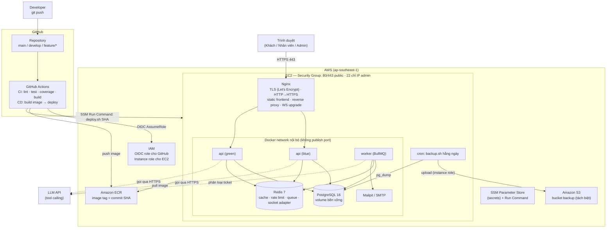
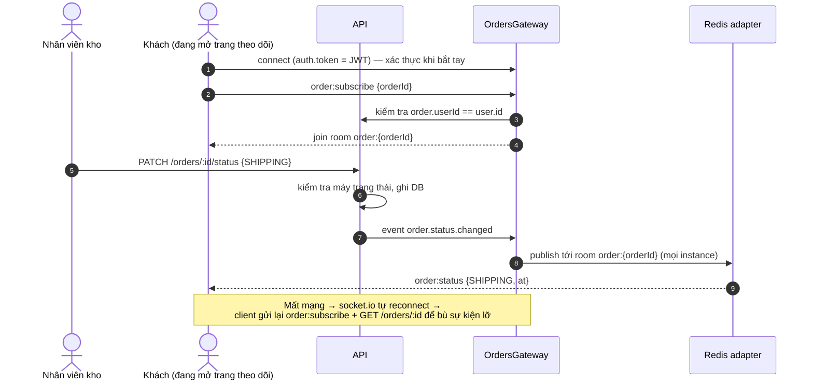
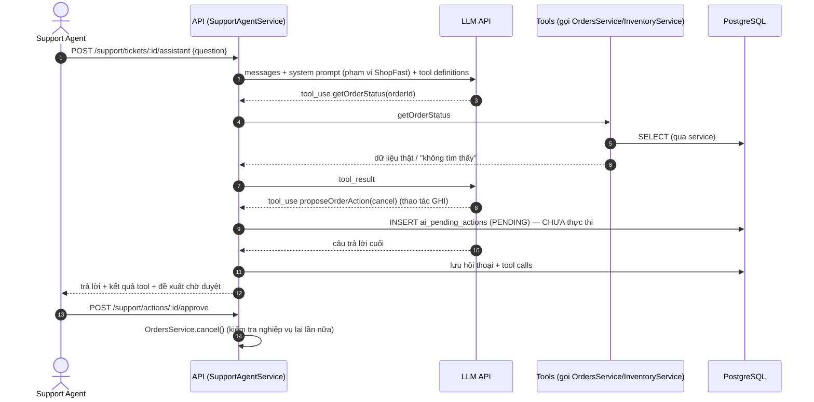

# Kiến trúc hệ thống — ShopFast

> Trạng thái: **bản thiết kế (Phase 0)**. Sẽ cập nhật khi hiện thực thay đổi.

## 1. Phong cách kiến trúc: Modular Monolith

ShopFast là **một ứng dụng NestJS** chia thành nhiều **module** theo nghiệp vụ (auth, products,
orders, support…), chạy dưới **2 loại tiến trình** từ cùng một mã nguồn / cùng một Docker image:

| Tiến trình | Lệnh chạy | Nhiệm vụ |
|---|---|---|
| `api` | `node dist/main.js` | HTTP REST API + WebSocket Gateway |
| `worker` | `node dist/worker.js` | Xử lý job BullMQ (email, hoá đơn, đồng bộ kho, phân loại ticket, job theo lịch) |

**Vì sao không làm microservices?** Đội 1 người, 200k khách hàng, 1 EC2 → microservices chỉ thêm
độ phức tạp (mạng, triển khai, giao dịch phân tán) mà không giải quyết bài toán nào trong SRS.
Tách `worker` ra tiến trình riêng là đủ để job nặng không làm chậm API. Chi tiết: TD-01 trong
[technical-decisions.md](technical-decisions.md).

## 2. Sơ đồ tổng thể (môi trường production trên AWS)



Điểm chính để trả lời hội đồng:

- **Chỉ Nginx** nhận traffic từ Internet. PostgreSQL / Redis **không có `ports:`** trong compose prod
  → không thể kết nối từ ngoài, kể cả khi lỡ mở Security Group.
- **Không có access key dài hạn**: GitHub Actions lấy credential tạm thời qua **OIDC**; EC2 dùng
  **Instance Profile** để pull ECR, đọc SSM, ghi S3.
- Deploy qua **SSM Run Command** → không cần mở SSH cho GitHub.
- **Blue/green**: luôn có 1 màu đang phục vụ; màu mới chỉ nhận traffic khi `/health/ready` OK.

## 3. Bảng thành phần & lý do chọn

| Thành phần | Công nghệ | Vai trò | Lý do chọn |
|---|---|---|---|
| Backend framework | NestJS 10 + TypeScript | API, DI, module, guard | SRS bắt buộc; kế thừa Module 5; cấu trúc module rõ ràng giúp tách tầng |
| Runtime | Node.js 20 LTS | | SRS bắt buộc |
| ORM | **Prisma 5** | Truy cập DB, migration | Type-safe, schema 1 file dễ đọc, migration rõ ràng, `$transaction` (TD-02) |
| CSDL | PostgreSQL 16 | Dữ liệu nghiệp vụ | SRS bắt buộc; giao dịch ACID cần cho chống bán vượt |
| Cache / store | Redis 7 (`ioredis`) | Cache, bộ đếm rate limit, queue, Socket.IO adapter | SRS bắt buộc; 1 thành phần phục vụ 4 nhu cầu |
| Hàng đợi | BullMQ (`@nestjs/bullmq`) | Job nền, retry, backoff, delayed, repeatable | PRD/SRS; chạy trên Redis có sẵn |
| Realtime | Socket.IO (`@nestjs/websockets`) + `@socket.io/redis-adapter` | Theo dõi đơn | Tự reconnect, rooms; redis-adapter cho nhiều instance |
| Rate limit | `@nestjs/throttler` + storage Redis | F03 | Tích hợp sẵn NestJS, hỗ trợ `getTracker` tuỳ biến |
| Health | `@nestjs/terminus` | F07.1 | Chuẩn NestJS |
| API docs | `@nestjs/swagger` | F07.3 | Sinh tự động từ decorator |
| Auth | `@nestjs/jwt`, `passport-jwt`, `bcrypt` | F06.4 | Phổ biến, dễ giải thích |
| Validation | `class-validator`, `class-transformer` | Kiểm tra input | Chuẩn NestJS `ValidationPipe` |
| AI | LLM SDK (mặc định Anthropic Claude) sau **adapter interface** + `MockLlmAdapter` | F01 | Tool calling chuẩn; adapter cho phép đổi nhà cung cấp / test không tốn tiền (TD-07) |
| Email | `nodemailer` + **Mailpit** (local/demo) | F05 | Mailpit có giao diện web xem email → dễ demo "đúng 1 email/đơn" |
| Frontend | React 18 + Vite + TypeScript | UI web | PRD |
| UI kit | **Mantine 7** | Component, form, notification, responsive | Bộ component đầy đủ, ít code tự viết (TD-09) |
| Data fetching | TanStack Query + axios | Gọi API, loading/error state | Cache phía client, retry, trạng thái loading chuẩn |
| Reverse proxy | Nginx | TLS, static, proxy, WebSocket upgrade, blue/green switch | PRD/SRS |
| Container | Docker multi-stage + Docker Compose | Đóng gói | SRS bắt buộc |
| CI/CD | GitHub Actions | Kiểm thử, build, deploy | SRS/PRD |
| Registry | Amazon ECR | Lưu image theo SHA | Cùng AWS, pull bằng instance role không cần mật khẩu |
| Hạ tầng | AWS EC2 (+ S3, IAM, SSM) | Chạy hệ thống | SRS bắt buộc |
| Kiểm thử | Jest + Supertest | Unit / integration | PRD; mặc định của NestJS |
| Đo hiệu năng | k6 (chạy bằng Docker) | Đo p95 | Báo cáo p95 trực tiếp; không cần cài |

## 4. Cấu trúc thư mục dự kiến

```
shopfast/
├── backend/
│   ├── prisma/                 schema.prisma, migrations/, seed.ts
│   ├── src/
│   │   ├── main.ts             khởi động API
│   │   ├── worker.ts           khởi động worker BullMQ
│   │   ├── app.module.ts
│   │   ├── common/             filters, guards, decorators, pipes, interceptors
│   │   ├── config/             đọc & validate biến môi trường
│   │   ├── prisma/             PrismaService
│   │   ├── redis/              kết nối Redis dùng chung
│   │   ├── auth/  users/
│   │   ├── catalog/            products, categories, brands
│   │   ├── inventory/
│   │   ├── cart/  orders/  promotions/
│   │   ├── support/            tickets, messages, pending actions
│   │   ├── ai/                 llm adapters, tools, agent loop, guardrails
│   │   ├── realtime/           orders.gateway.ts
│   │   ├── cache/              CacheService, metrics
│   │   ├── rate-limit/
│   │   ├── jobs/               queues, processors, schedulers
│   │   ├── health/  admin/
│   └── test/                   integration tests (*.e2e-spec.ts)
├── frontend/
│   └── src/  pages/ components/ api/ hooks/ realtime/ auth/
├── infra/
│   ├── nginx/  deploy/  backup/  aws/ (IAM policy JSON)
├── perf/                       kịch bản k6
├── docs/
├── docker-compose.yml          dev
├── docker-compose.prod.yml
└── .github/workflows/          ci.yml, cd.yml
```

### Phân tầng trong mỗi module (NFR-TECH-04)

```
Controller  ── nhận HTTP, validate DTO, gọi service, KHÔNG có logic nghiệp vụ
   │
Service     ── logic nghiệp vụ (kiểm tra tồn kho, máy trạng thái đơn, quyền sở hữu)
   │
Repository  ── truy vấn Prisma; là nơi DUY NHẤT gọi PrismaClient
```

Tầng AI (`ai/tools/*`) cũng gọi **Service**, không gọi Repository/Prisma → AI dùng đúng quy tắc
nghiệp vụ và phân quyền như API thường.

## 5. Sơ đồ luồng dữ liệu (Data Flow)

### 5.1 Đặt đơn hàng (F06.2 + F05 + F02 + F04)

```mermaid
sequenceDiagram
  autonumber
  actor C as Khách hàng
  participant N as Nginx
  participant A as API (OrdersService)
  participant DB as PostgreSQL
  participant R as Redis
  participant Q as BullMQ
  participant W as Worker

  C->>N: POST /orders (JWT, Idempotency-Key)
  N->>A: proxy
  A->>R: rate limit check (user:{id})
  A->>DB: BEGIN
  A->>DB: UPDATE products SET stock = stock - n WHERE id = ? AND stock >= n
  alt không đủ hàng (0 dòng)
    A->>DB: ROLLBACK
    A-->>C: 409 "Sản phẩm X không đủ hàng"
  else đủ hàng
    A->>DB: INSERT orders, order_items, status_history; xoá cart
    A->>DB: COMMIT
    A->>R: xoá cache product:{id}, INCR products:list:version
    A->>Q: add email(jobId=order-confirmation:{orderId}), invoice, inventory-sync,<br/>payment-reminder (delay 30')
    A-->>C: 201 Created (không chờ email)
    Q->>W: xử lý job
    W->>DB: INSERT email_logs (unique orderId,type) → gửi email
  end
```

### 5.2 Kho cập nhật trạng thái → khách nhận realtime (F02)



### 5.3 Trợ lý AI cho nhân viên CSKH (F01)



## 6. Suy giảm có kiểm soát (NFR-REL-04)

| Thành phần hỏng | Hành vi hệ thống |
|---|---|
| Redis (cache) | Bỏ qua cache, đọc DB; log cảnh báo; `/health` báo `redis: down` nhưng `/health/live` vẫn OK |
| Redis (rate limit) | Chọn **fail-open** cho giới hạn chung (vẫn phục vụ) — riêng đăng nhập dùng thêm bộ đếm in-memory dự phòng. Ghi trong `security-report.md` |
| Redis (queue) | Đơn vẫn tạo được; việc thêm job lỗi được ghi vào bảng outbox để đẩy lại (xem TD-10) |
| LLM API | Phân loại ticket dùng bộ từ khoá dự phòng; trợ lý AI trả thông báo "Trợ lý AI tạm thời không khả dụng", nhân viên vẫn xử lý ticket thủ công |
| SMTP | Job email retry + backoff, hết lượt → `failed_jobs`; admin chạy lại |
| PostgreSQL | Không thể phục vụ nghiệp vụ → `/health/ready` 503 → deploy không chuyển traffic sang bản mới; quy trình khôi phục ở `backup-recovery-report.md` |
