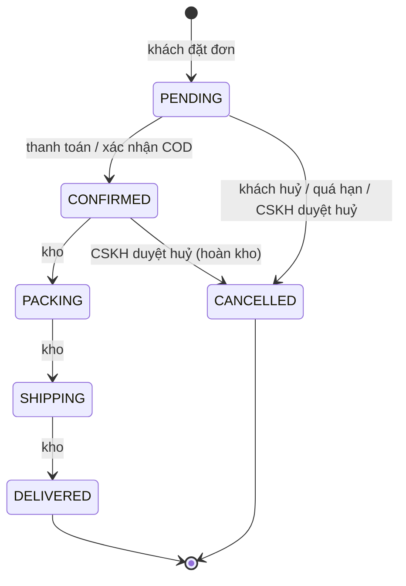

# Thiết kế cơ sở dữ liệu — ShopFast

> PostgreSQL 16, quản lý schema bằng **Prisma** (migration trong `backend/prisma/migrations`).
> Trạng thái: **bản thiết kế (Phase 0)** — các bảng sẽ được tạo dần theo từng phase.

## 1. Quy ước

- Khoá chính: `id` kiểu **UUID** (`gen_random_uuid()`), tránh lộ số lượng đơn/khách qua ID tăng dần
  và tránh dò ID kế tiếp.
- Tiền: **số nguyên VND** (`INTEGER`) — VND không có phần lẻ, tránh lỗi làm tròn số thực.
  Giới hạn ~2,1 tỷ VND/giá trị là đủ cho một đơn TMĐT; validate ở DTO.
- Thời gian: `TIMESTAMPTZ` (lưu UTC, hiển thị giờ Việt Nam ở frontend).
- Tên bảng/cột: `snake_case` trong DB, `camelCase` trong Prisma (`@map`).
- Mọi bảng có `created_at`; bảng có thể sửa có thêm `updated_at`.

## 2. ERD

```mermaid
erDiagram
  users ||--o{ refresh_tokens : has
  users ||--o| carts : owns
  users ||--o{ orders : places
  users ||--o{ tickets : opens
  users ||--o{ verification_codes : receives

  categories ||--o{ products : contains
  categories ||--o{ categories : "parent of"
  brands ||--o{ products : makes

  carts ||--o{ cart_items : contains
  products ||--o{ cart_items : "in"

  orders ||--|{ order_items : contains
  products ||--o{ order_items : "sold as"
  orders ||--o{ order_status_history : tracks
  orders ||--o| invoices : has
  orders ||--o{ email_logs : triggers
  promotions ||--o{ orders : "applied to"

  products ||--o{ inventory_movements : logs
  orders ||--o{ inventory_movements : causes

  tickets ||--o{ ticket_messages : contains
  tickets ||--o{ ai_tool_calls : records
  tickets ||--o{ ai_pending_actions : proposes
  orders ||--o{ tickets : "about (optional)"

  users {
    uuid id PK
    string email UK
    string password_hash
    string full_name
    enum role "CUSTOMER|SUPPORT_AGENT|WAREHOUSE_STAFF|ADMIN"
    bool email_verified
    bool is_active
    timestamptz created_at
  }
  refresh_tokens {
    uuid id PK
    uuid user_id FK
    string token_hash UK
    timestamptz expires_at
    timestamptz revoked_at
    uuid replaced_by_id
  }
  verification_codes {
    uuid id PK
    uuid user_id FK
    enum purpose "VERIFY_EMAIL|RESET_PASSWORD"
    string code_hash
    int attempts
    timestamptz expires_at
    timestamptz used_at
  }
  categories {
    uuid id PK
    string name
    string slug UK
    uuid parent_id FK
  }
  brands {
    uuid id PK
    string name
    string slug UK
  }
  products {
    uuid id PK
    string sku UK
    string name
    string slug UK
    text description
    int price
    int stock
    string image_url
    uuid category_id FK
    uuid brand_id FK
    bool is_active
    int version
    timestamptz updated_at
  }
  inventory_movements {
    uuid id PK
    uuid product_id FK
    int delta
    enum reason "ORDER|CANCEL|MANUAL_ADJUST|PARTNER_SYNC"
    uuid order_id FK
    uuid actor_id FK
    timestamptz created_at
  }
  carts {
    uuid id PK
    uuid user_id FK,UK
  }
  cart_items {
    uuid id PK
    uuid cart_id FK
    uuid product_id FK
    int quantity
  }
  promotions {
    uuid id PK
    string code UK
    int discount_percent
    int max_uses
    int used_count
    int per_user_limit
    timestamptz starts_at
    timestamptz ends_at
  }
  orders {
    uuid id PK
    string code UK "SF-20261031-0001"
    uuid user_id FK
    enum status
    enum payment_status "UNPAID|PAID|REFUNDED"
    enum payment_method "COD|MOCK_ONLINE"
    int subtotal
    int discount
    int total
    uuid promotion_id FK
    string idempotency_key
    json shipping_address
    timestamptz paid_at
    timestamptz created_at
  }
  order_items {
    uuid id PK
    uuid order_id FK
    uuid product_id FK
    string product_name "snapshot"
    int unit_price "snapshot"
    int quantity
  }
  order_status_history {
    uuid id PK
    uuid order_id FK
    enum from_status
    enum to_status
    uuid changed_by FK
    string note
    timestamptz created_at
  }
  invoices {
    uuid id PK
    uuid order_id FK,UK
    string number UK
    string file_path
    timestamptz created_at
  }
  email_logs {
    uuid id PK
    uuid order_id FK
    enum type "ORDER_CONFIRMATION|PAYMENT_REMINDER|..."
    string to_email
    enum status "SENDING|SENT|FAILED"
    string provider_message_id
    timestamptz sent_at
  }
  tickets {
    uuid id PK
    uuid customer_id FK
    uuid order_id FK "nullable"
    string subject
    enum status "OPEN|IN_PROGRESS|RESOLVED|CLOSED"
    enum category "nullable cho tới khi phân loại"
    float category_confidence
    enum classified_by "AI|FALLBACK|HUMAN"
    uuid assigned_agent_id FK
    timestamptz created_at
  }
  ticket_messages {
    uuid id PK
    uuid ticket_id FK
    enum author_type "CUSTOMER|AGENT|AI|SYSTEM"
    uuid author_id FK "nullable"
    text content
    timestamptz created_at
  }
  ai_tool_calls {
    uuid id PK
    uuid ticket_id FK
    uuid requested_by FK
    string tool_name
    json input
    json output
    bool success
    int duration_ms
    timestamptz created_at
  }
  ai_pending_actions {
    uuid id PK
    uuid ticket_id FK
    string action_type "CANCEL_ORDER|..."
    json payload
    text reason
    enum status "PENDING|APPROVED|REJECTED|EXECUTED|FAILED"
    uuid reviewed_by FK
    timestamptz reviewed_at
  }
  failed_jobs {
    uuid id PK
    string queue
    string job_id
    string job_name
    json payload
    text failed_reason
    text stacktrace
    int attempts_made
    timestamptz failed_at
    timestamptz retried_at
  }
  daily_revenue_reports {
    uuid id PK
    date report_date UK
    int order_count
    int revenue
    json breakdown
  }
  job_outbox {
    uuid id PK
    string queue
    string job_name
    string job_id UK
    json payload
    timestamptz dispatched_at
  }
```



## 3. Enum trạng thái đơn hàng & máy trạng thái



Chỉ những chuyển trạng thái trên mới hợp lệ (kiểm tra trong `OrderStateMachine`, có unit test).
Huỷ đơn → **cộng lại tồn kho** trong cùng transaction + ghi `inventory_movements`.

## 4. Ràng buộc quan trọng (đều phục vụ yêu cầu SRS)

| Ràng buộc | Mục đích | Yêu cầu |
|---|---|---|
| `CHECK (products.stock >= 0)` | Lớp bảo vệ cuối cùng chống bán vượt, kể cả khi code có bug | F06.2 |
| `UNIQUE (orders.user_id, orders.idempotency_key)` | Bấm "Đặt hàng" 2 lần / mạng retry → không tạo 2 đơn | F06.2 |
| `UNIQUE (email_logs.order_id, email_logs.type)` | Mỗi đơn chỉ 1 email xác nhận dù job chạy lại | F05.3 |
| `UNIQUE (invoices.order_id)` | Không xuất 2 hoá đơn cho 1 đơn | F05.3 |
| `UNIQUE (daily_revenue_reports.report_date)` | Job báo cáo chạy lại không tạo bản trùng | F05.3, F05.4 |
| `UNIQUE (job_outbox.job_id)` | Không đẩy trùng job | F05.3 |
| `UNIQUE (refresh_tokens.token_hash)` | Tra cứu nhanh, phát hiện tái sử dụng token | F06.4 |
| `order_items.unit_price` lưu bản chụp giá | Đổi giá sản phẩm không làm thay đổi đơn cũ | F06.3 |

## 5. Index (phục vụ lọc & phân trang F06.1, hiệu năng NFR-PERF)

| Index | Truy vấn phục vụ |
|---|---|
| `products (category_id, price)` | Lọc theo danh mục + khoảng giá |
| `products (brand_id, price)` | Lọc theo thương hiệu + khoảng giá |
| `products (is_active, created_at DESC)` | Danh sách mặc định mới nhất |
| `orders (user_id, created_at DESC)` | Lịch sử đơn của khách |
| `orders (status, created_at)` | Màn hình kho, job nhắc thanh toán |
| `tickets (status, created_at)` | Danh sách ticket của CSKH |
| `order_status_history (order_id, created_at)` | Dòng thời gian của đơn |

Phân trang: dùng `page/limit` (offset) cho đơn giản và dễ hiển thị số trang; giới hạn
`limit ≤ 50` để tránh truy vấn quá nặng. (Keyset pagination là hướng nâng cấp nếu dữ liệu lớn.)

## 6. Chống bán vượt — vì sao câu lệnh này an toàn

```sql
UPDATE products
SET stock = stock - $qty, version = version + 1
WHERE id = $id AND stock >= $qty;
-- 1 dòng bị ảnh hưởng → trừ kho thành công
-- 0 dòng → không đủ hàng → ROLLBACK cả đơn
```

PostgreSQL khoá dòng khi `UPDATE`. Nếu 2 transaction cùng trừ sản phẩm còn 1, transaction thứ 2
phải **chờ** transaction thứ nhất commit, rồi **đánh giá lại** điều kiện `stock >= qty` với giá trị
mới (= 0) → 0 dòng → thất bại. Không cần `SELECT ... FOR UPDATE` riêng. Prisma viết được bằng
`updateMany({ where: { id, stock: { gte: qty } }, data: { stock: { decrement: qty } } })`.

## 7. Dữ liệu seed (giả định SRS: "dữ liệu nạp sẵn bằng script seed")

`prisma/seed.ts` tạo: 4 tài khoản mẫu (mỗi role 1), ~10 danh mục, ~15 thương hiệu, ~500 sản phẩm,
~200 đơn mẫu ở các trạng thái, vài ticket. Mật khẩu mẫu chỉ dùng cho môi trường dev/demo và được
in trong README; **không** dùng ở production.
