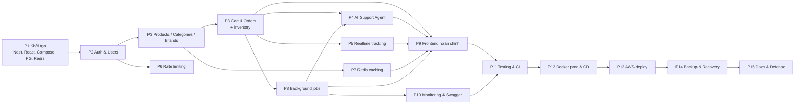

# Lộ trình phát triển — ShopFast

## 1. Quy trình Git

```
main      ── chỉ nhận merge từ develop khi phát hành (release); được bảo vệ
develop   ── nhánh tích hợp; nhận PR từ feature/*; được bảo vệ (CI phải xanh)
feature/* ── mỗi tính năng một nhánh, tách từ develop
```

Mỗi tính năng: tạo nhánh → code → `lint` + `format` → unit test → integration test → sửa lỗi →
cập nhật docs + ma trận truy vết → review → commit (Conventional Commits) → PR vào `develop`.
Không commit rỗng, không sửa timestamp, không báo "test pass" khi chưa chạy.

## 2. Phụ thuộc giữa các tính năng



Ghi chú: phân loại ticket (P4) chạy trong queue nên P4 dùng hạ tầng BullMQ — ta dựng sẵn BullMQ
tối thiểu ở P4 rồi mở rộng ở P8, hoặc làm P8 trước P4 (đề xuất: **làm P8 trước P4**). CI cơ bản
(lint + unit test) bật từ **P1** để mọi PR đều được kiểm tra; P11 chỉ hoàn thiện thêm.

## 3. Các phase

| Phase | Nhánh | Nội dung chính | Kết quả kiểm chứng được | Yêu cầu |
|---|---|---|---|---|
| P0 | `feature/requirements-analysis` | Phân tích SRS, kiến trúc, ERD, roadmap | Bộ tài liệu `docs/` được bạn duyệt | Tất cả |
| P1 | `feature/project-setup` | Monorepo backend/frontend, ESLint/Prettier, `.env.example`, Compose (PG 16, Redis 7, Mailpit), `/health` cơ bản, README, **CI cơ bản** | `docker compose up` + `npm run start:dev` chạy; `/health` 200; CI xanh | NFR-TECH-01/02, F07.1 |
| P2 | `feature/authentication` | Prisma schema users/refresh_tokens, register/login/refresh/logout, bcrypt, JWT, RolesGuard, OTP | Unit + integration test auth/authorization | F06.4 |
| P3 | `feature/product-management` | Categories, brands, products CRUD, lọc, phân trang, seed | Integration test lọc/phân trang | F06.1 |
| P3 | `feature/order-management` | Cart, orders, inventory, state machine, idempotency key, khuyến mãi | Test đồng thời chống bán vượt | F06.2, F06.3 |
| P8 | `feature/background-jobs` | BullMQ, worker, email/invoice/inventory-sync, DLQ, outbox, lịch | Test idempotency 1 email/đơn | F05.* |
| P4 | `feature/ai-support-agent` | Tickets, phân loại, LLM adapter, 2 tool, pending actions | Test tool + duyệt thao tác ghi | F01.* |
| P5 | `feature/realtime-tracking` | Gateway, auth handshake, rooms, Redis adapter, reconnect | Test socket ủy quyền | F02.* |
| P6 | `feature/rate-limiting` | Throttler Redis, tracker, filter 429, chống dò mật khẩu | Test 429 + Retry-After | F03.* |
| P7 | `feature/redis-caching` | CacheService, invalidation, stampede/penetration, fallback, metrics | Test cache + đo k6 thật | F04.*, NFR-PERF-01/04 |
| P9 | `feature/frontend-*`, `feature/admin-dashboard` | Toàn bộ trang Public / Customer / Staff / Admin | Demo luồng đầu-cuối | D08 |
| P10 | `feature/monitoring` | Health đầy đủ, queue dashboard, Swagger | `/api/docs`, `/admin/queues` | F07.1–3 |
| P11 | `feature/testing-quality` | Bổ sung test, coverage threshold 60%, gitleaks | Coverage report thật | NFR-QUA-01/02 |
| P12 | `feature/ci-cd` | Dockerfile multi-stage, Nginx, compose prod, CD blue/green, rollback, PR test-fail mẫu | Run thành công + run bị chặn | NFR-REL-01/02, NFR-QUA-03, D03 |
| P13 | `feature/aws-deployment` | Script AWS CLI + hướng dẫn Console: EC2, SG, IAM OIDC, ECR, S3, SSM, certbot | Domain HTTPS chạy (khi bạn duyệt + có tài khoản) | NFR-SEC-*, D01 |
| P14 | `feature/backup-recovery` | backup.sh, restore.sh, lifecycle S3, diễn tập | Biên bản đo thời gian thật | F07.4, NFR-REL-03 |
| P15 | `docs/final-defense` | Tài liệu cuối, sơ đồ, demo script, câu hỏi bảo vệ, slide | Bộ tài liệu bàn giao | D04–D07, R06 |

Sau mỗi phase sẽ có **báo cáo phase** theo mẫu trong PRD (PHASE / FEATURE / BRANCH / FILES /
TESTS / RESULTS / COMMIT / GIT COMMANDS / NEXT PHASE).

## 4. Rủi ro kỹ thuật & cách giảm thiểu

| # | Rủi ro | Ảnh hưởng | Khả năng | Giảm thiểu |
|---|---|---|---|---|
| RK1 | Chưa có **domain / tài khoản AWS** | Mất 25% điểm R01, không có D01 | Trung bình | Hỏi sớm; domain giá rẻ (.id.vn / .xyz) hoặc subdomain miễn phí (DuckDNS) + Let's Encrypt; chuẩn bị script sẵn |
| RK2 | Chưa biết **nhà cung cấp AI** / hết hạn mức key | F01 không demo được | Trung bình | Adapter + Mock (ghi nhãn); hỏi bạn loại key; giới hạn số vòng tool & token |
| RK3 | Repo GitHub **private** trên gói Free không bật được branch protection | Không chứng minh "khoá merge" (NFR-QUA-02) | Cao nếu private | Dùng repo **public** (đảm bảo không có secret) hoặc GitHub Pro/Education miễn phí cho sinh viên |
| RK4 | EC2 nhỏ (t2/t3.micro, 1 GB RAM) không đủ chạy PG + Redis + 2 API + worker + build | Sập khi deploy blue/green | Cao | Build image trên GitHub Actions (không build trên EC2); dùng **t3.small (2 GB)** + swap; giới hạn memory container |
| RK5 | Chi phí AWS vượt Free Tier | Phát sinh tiền | Trung bình | Bật AWS Budgets cảnh báo; tắt instance khi không dùng; ECR lifecycle giữ 10 image |
| RK6 | Đo hiệu năng không đạt ngưỡng (p95 < 50 ms qua Internet) | NFR-PERF | Trung bình | Đo **tại server** (loại trừ độ trễ mạng của người đo) và qua Internet, ghi cả 2, giải thích trung thực |
| RK7 | Race condition chống bán vượt sai | Bán vượt — lỗi nghiệp vụ nghiêm trọng | Thấp | UPDATE có điều kiện + CHECK constraint + test đồng thời |
| RK8 | Migration DB làm hỏng blue/green | Downtime | Thấp | Migration tương thích ngược; chạy migration trước khi chuyển traffic |
| RK9 | Lộ secret khi commit | Bảo mật | Trung bình | `.gitignore`, `.env.example`, gitleaks trong CI + pre-commit |
| RK10 | Phạm vi quá lớn so với thời gian | Không kịp | Cao | Ưu tiên theo trọng số rubric: chạy thật + tích hợp (50%) trước; frontend làm gọn bằng Mantine |
| RK11 | **Bạn không giải thích được code** (R06 bắt buộc) | Không được công nhận kết quả | — | Mỗi phase giải thích bằng tiếng Việt; code ngắn gọn, tránh "ma thuật"; `defense-questions.md` |

## 5. Thứ tự ưu tiên nếu thiếu thời gian

1. P1–P3 (nền tảng) → 2. P8, P7, P6, P5, P4 (5 chủ đề tích hợp, R02) → 3. P12–P13 (chạy thật +
tự động hoá, R01 + R03 = 45%) → 4. P14, P10 → 5. P9 hoàn thiện UI → 6. P15.
